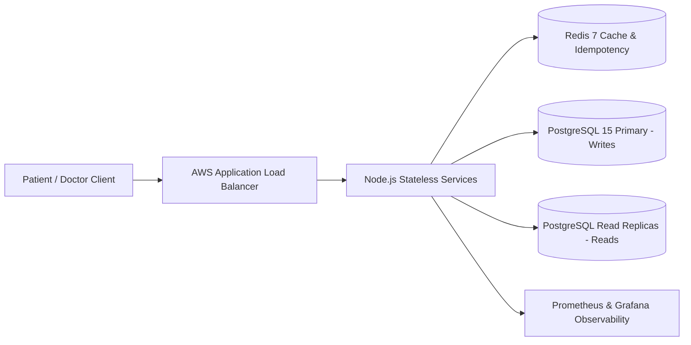
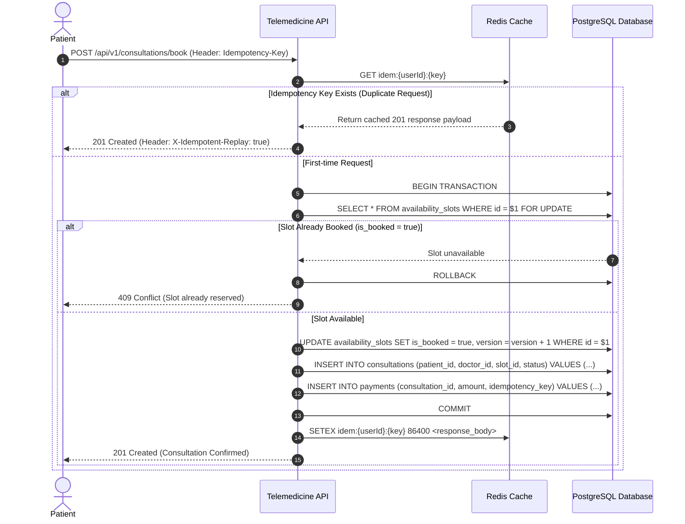
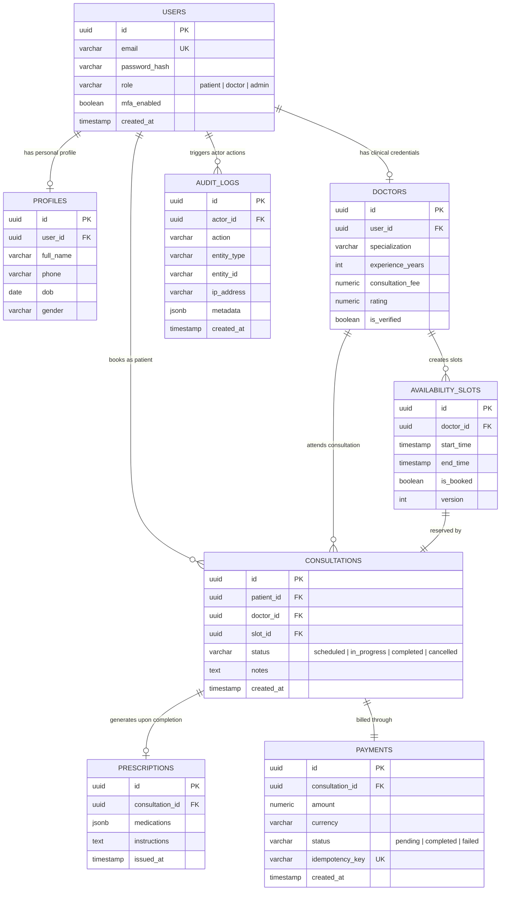

# Amrutam Telemedicine System — Architecture Document

## 1. High-Level Architecture & Data Flow
- **Client Layer**: Mobile and Web client apps communicating over TLS 1.3 via REST APIs.
- **API Gateway / Ingress**: NGINX / AWS Application Load Balancer terminating SSL, performing global rate limiting, and routing traffic.
- **Stateless Application Tier**: Horizontal Pod Autoscaling (HPA) of containerized Node.js services configured with non-blocking event loops.
- **Caching & Idempotency Layer**: Redis 7 cluster storing cached query models and idempotency keys with a 24-hour Time-To-Live (TTL).
- **Persistence Tier**: PostgreSQL 15 Primary instance (handling writes) paired with asynchronous Read Replicas fronted by PgBouncer for connection pooling.

---

## 2. Booking Flow Sequence Diagram (ACID & Idempotency Guarantee)

---

## 3. Entity-Relationship (ER) Diagram

---

## 4. Retry and Backoff Strategies
- **Client Retries**: Implemented with exponential backoff and randomized full jitter to eliminate thundering herd spikes during network degradation:
  \[T_{\text{wait}} = \text{random}(0, \min(T_{\max}, T_{\text{base}} \times 2^{\text{attempt}}))\]
- **Safe Network Retries**: The mandatory `Idempotency-Key` header on all write requests (`POST`, `PUT`, `PATCH`) guarantees that network dropouts and aggressive client retries never create duplicate consultation records or double billing.

---

## 5. Data Partitioning Strategy (100k Daily Consultations)
- **Time-Range Partitioning**: The `consultations` and `audit_logs` tables generate an estimated ~3 million rows per month. PostgreSQL declarative range partitioning (`PARTITION BY RANGE (created_at)`) isolates active month data from historical cold storage, keeping working index sets cached in RAM.
- **Indexing Topology**:
  - Composite B-Tree index on `availability_slots(doctor_id, is_booked, start_time)` ensures fast slot discovery ($< 50\text{ms}$).
  - Trigram inverted index (`gin_trgm_ops`) on `doctors(specialization)` for high-throughput text search.

---

## 6. Caching and Concurrency Handling
- **Race Condition Prevention**: Double-booking is strictly prevented via PostgreSQL pessimistic row locking (`SELECT ... FOR UPDATE`) inside an explicit transaction boundary. Two concurrent requests attempting to claim the same `slot_id` are serialized; the second request encounters `is_booked = true` and yields an immediate `409 Conflict`.
- **Query Caching**: Doctor directory results are cached in Redis with a 10-minute TTL. Slot creation and booking operations execute write-through cache invalidation (`DEL doctors:search:*`).

---

## 7. Transaction Management and Sagas
- **Local ACID Boundaries**: Slot reservation, consultation initialization, and internal payment ledgers commit atomically inside single database transactions (`BEGIN` ... `COMMIT`).
- **Distributed Saga (Compensating Actions)**: For third-party gateway interactions (Razorpay/Stripe), an asynchronous Choreography Saga handles asynchronous failures:
  - If a payment webhook arrives with status `failed`, a worker triggers a compensating event to mark the consultation as `cancelled` and frees the slot (`is_booked = false`).

---

## 8. Backup and Disaster Recovery (Target: 99.95% Availability)
- **Recovery Point Objective (RPO) < 1 minute**: Continuous PostgreSQL Write-Ahead Log (WAL) archiving to AWS S3 bucket storage paired with synchronous multi-Availability Zone hot standbys.
- **Recovery Time Objective (RTO) < 5 minutes**: Automated health check failovers managed via AWS RDS Multi-AZ / Patroni orchestrator to promote the replica with zero manual intervention.