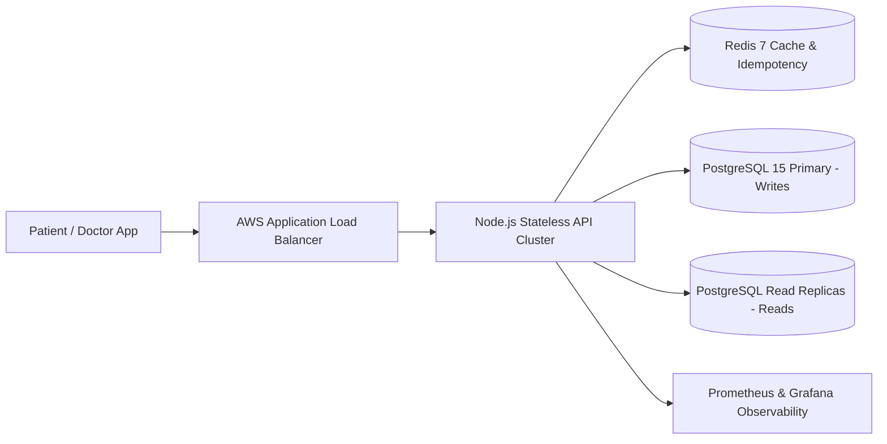
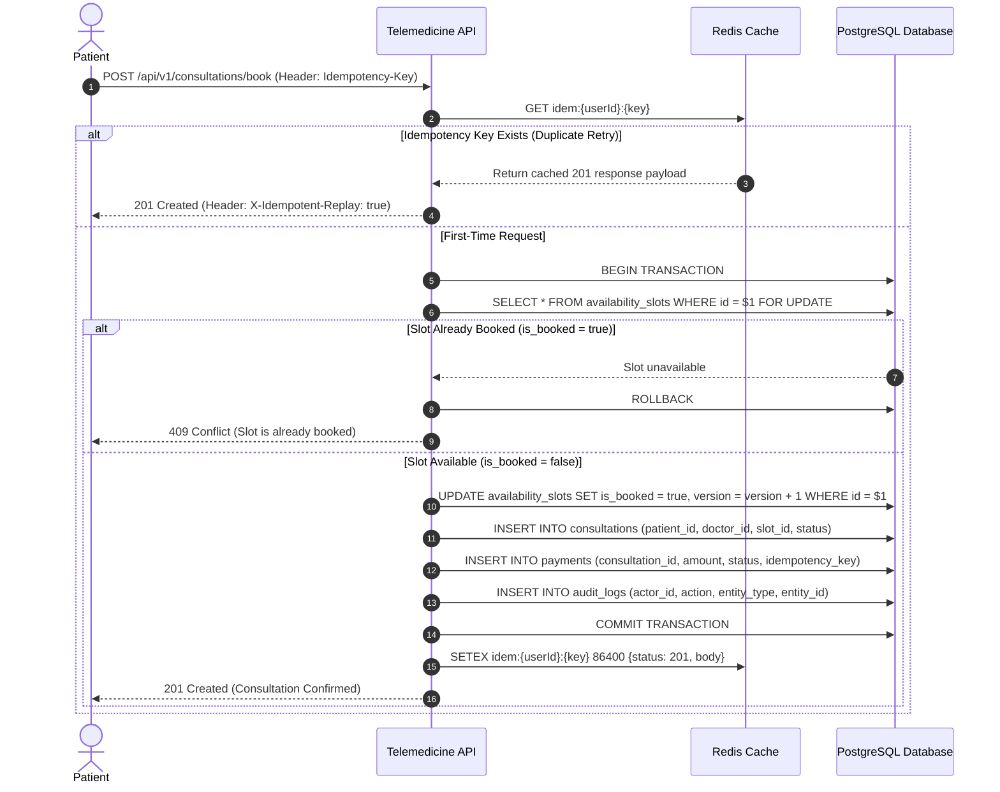
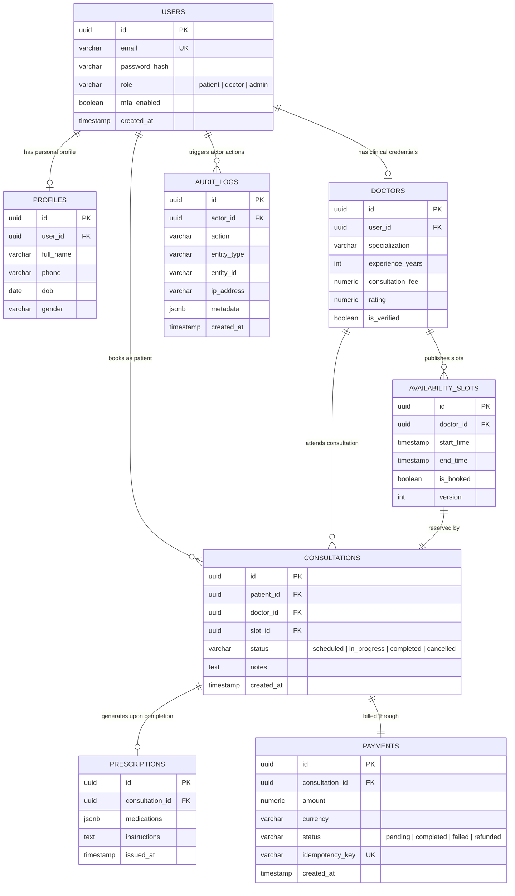

<a name="architecture-top"></a>

# 🏗️ Amrutam Telemedicine System — Architecture Document

A comprehensive **system design and architectural blueprint** engineered to sustain **100,000+ daily consultations**, guarantee **sub-200ms read latency (p95)**, maintain **99.95% high availability**, and enforce **strict ACID concurrency and write idempotency**.

---

## 1. High-Level Architecture & Data Flow

- **Client Layer:** Mobile (iOS/Android) and Web applications communicating exclusively over TLS 1.3 via RESTful JSON APIs.
- **API Gateway / Ingress:** NGINX / AWS Application Load Balancer terminating SSL, enforcing global IP rate-limiting, and routing traffic.
- **Stateless Application Tier:** Horizontally auto-scaled (Kubernetes HPA) Node.js & Express.js containers running non-blocking event loops.
- **Caching & Idempotency Tier:** Redis 7 cluster storing active `Idempotency-Key` response payloads (24-hour TTL) and hot doctor directory search caches.
- **Persistence Tier:** PostgreSQL 15 Primary instance (handling ACID write transactions) paired with Read Replicas fronted by PgBouncer connection pooling.
- **Observability Tier:** Prometheus scraping real-time latency histograms (`/metrics`) and Winston streaming structured JSON logs.



---

## 2. Booking Flow Sequence Diagram (ACID & Idempotency Guarantee)



---

## 3. Entity-Relationship (ER) Diagram



---

## 4. API Schema & Contract Specifications

- **OpenAPI 3.0 Standard:** Complete machine-readable REST specification maintained in [`docs/openapi.yaml`](./openapi.yaml).
- **Authentication & Authorization:** Stateless Bearer JWT verification paired with strict Role-Based Access Control (`patient`, `doctor`, `admin`).
- **Input Validation:** Strict schema validation enforced via `Joi` before controller execution, rejecting malformed payloads with HTTP `400 Bad Request`.

---

## 5. Retry and Backoff Strategies

- **Client Retries (Exponential Backoff + Full Jitter):** To prevent thundering herd spikes during transient network failures (`502`/`503`/`504`), clients compute retry delays using:
  ```text
  T_wait = random(0, min(T_max, T_base * (2 ^ attempt)))
  ```
  *(Where `T_base = 200ms`, `T_max = 3000ms`, and `max_attempts = 3`)*.
- **Zero-Duplicate Write Guarantee:** Every state-mutating request (`POST`, `PUT`, `PATCH`) requires a unique `Idempotency-Key` header. Retried requests hit the idempotency store (`idempotency_records` / Redis) and return the cached response (`X-Idempotent-Replay: true`) without re-executing business logic.

---

## 6. Data Partitioning Strategy (100k Daily Consultations)

- **Declarative Range Partitioning:** At 100,000 daily consultations (~3 million rows/month), `consultations`, `payments`, and `audit_logs` are partitioned monthly by `created_at` (`PARTITION BY RANGE (created_at)`). Partitions older than 90 days are detached and archived to cold storage, keeping active B-Tree indexes inside RAM.
- **Indexing Topology:**
  - Composite B-Tree index on `availability_slots(doctor_id, is_booked, start_time)` guarantees sub-50ms slot lookup.
  - Index on `doctors(specialization)` accelerates filtered practitioner searches.

---

## 7. Caching and Concurrency Handling

- **Pessimistic Row-Level Locking:** Double-booking is eliminated via PostgreSQL `SELECT ... FOR UPDATE` inside an explicit transaction boundary. Concurrent requests targeting the same `slot_id` are serialized at the database row lock; the second transaction reads `is_booked = true` and immediately returns `409 Conflict`.
- **Write-Through Cache Invalidation:** Doctor search queries are cached in Redis with a 10-minute TTL. Creating or booking a slot invalidates stale cache keys (`DEL doctors:search:*`).

---

## 8. Transaction Management and Sagas

- **Local ACID Boundaries:** Slot reservation, consultation creation, payment recording, and audit trail logging execute atomically inside a single PostgreSQL transaction (`BEGIN` ... `COMMIT` / `ROLLBACK`).
- **Distributed Saga (Compensating Workflow):** For external payment gateways (Razorpay/Stripe), a Choreography Saga manages asynchronous failures:
  1. Slot is locked with consultation status `scheduled` and payment status `pending`.
  2. If the payment webhook reports `failed` or times out after 10 minutes, a compensating transaction marks the consultation `cancelled` and releases the slot (`is_booked = false`).

---

## 9. Backup and Disaster Recovery (Target: 99.95% Availability)

- **Recovery Point Objective (RPO < 1 Minute):** Continuous PostgreSQL Write-Ahead Log (WAL) archiving to encrypted AWS S3 buckets paired with synchronous Multi-AZ standby replication.
- **Recovery Time Objective (RTO < 5 Minutes):** Automated health-check failover via AWS RDS Multi-AZ / Patroni promotes the hot standby to Primary within seconds without manual intervention.